# Day 5 — Active Directory Password Security & Account Lockout

## Project Overview

This lab demonstrates the configuration, verification, and troubleshooting of Active Directory domain password policies and account lockout controls using Windows Server 2025.

The exercise includes password policy enforcement, failed authentication testing, Windows Security Event Log investigation, and account recovery.

**Lab Type:** Personal cybersecurity and systems administration lab  
**Platform:** Oracle VirtualBox  
**Domain:** adlab.test  
**Domain Controller:** DC01  
**Client Workstation:** CLIENT01 (Windows 11)

---

## Lab Objectives

- Configure domain password complexity requirements.
- Establish account lockout thresholds and duration.
- Verify Active Directory security settings using PowerShell.
- Create a test account to validate password enforcement.
- Simulate failed authentication attempts.
- Investigate Windows Security Event Logs.
- Identify locked accounts and perform account recovery.
- Document troubleshooting procedures and results.

---

## Lab Environment

| Component | Configuration |
|---|---|
| Server | Windows Server 2025 |
| Client | Windows 11 |
| Virtualization | Oracle VirtualBox |
| Domain | adlab.test |
| Domain Controller | DC01 |
| Client Computer | CLIENT01 |
| Directory Service | Active Directory Domain Services |
| Management | Group Policy Management |
| Scripting | Windows PowerShell |
| Monitoring | Windows Event Viewer |

---

## 1. Password Policy Configuration

Configured the Default Domain Policy through Group Policy Management.

**Navigation:**

Computer Configuration → Policies → Windows Settings → Security Settings → Account Policies → Password Policy

### Configured Settings

| Security Setting | Value |
|---|---|
| Minimum password length | 12 characters |
| Password complexity | Enabled |
| Password history | 10 passwords remembered |
| Maximum password age | 90 days |
| Minimum password age | 1 day |
| Reversible password encryption | Disabled |

### Evidence

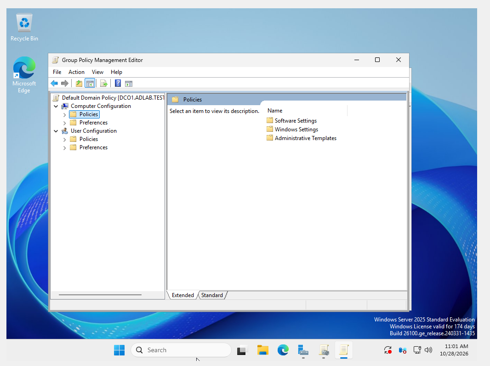

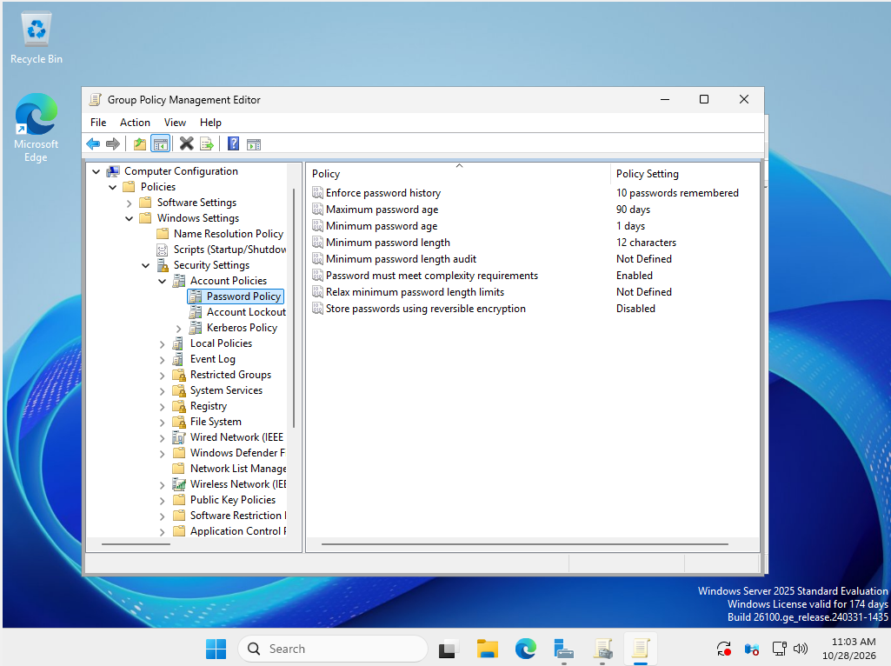

---

## 2. Account Lockout Configuration

Configured domain account lockout settings to help reduce repeated unauthorized authentication attempts.

**Navigation:**

Computer Configuration → Policies → Windows Settings → Security Settings → Account Policies → Account Lockout Policy

### Configured Settings

| Security Setting | Value |
|---|---|
| Account lockout threshold | 5 failed sign-in attempts |
| Account lockout duration | 15 minutes |
| Reset lockout counter after | 15 minutes |
| Allow Administrator account lockout | Enabled |

### Evidence

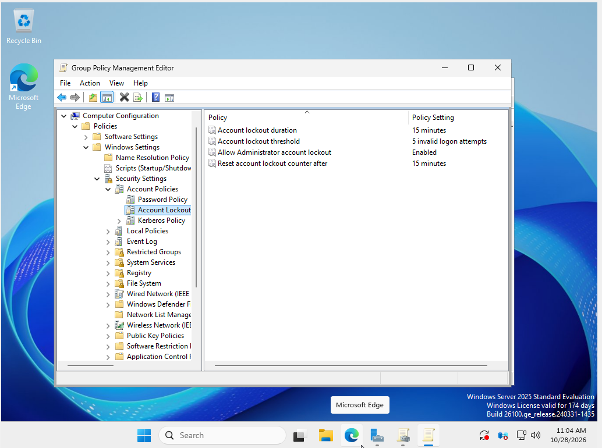

---

## 3. PowerShell Policy Verification

Used Windows PowerShell on the domain controller to verify the domain password and account lockout settings.

### Command

```powershell
Get-ADDefaultDomainPasswordPolicy |
Select-Object MinPasswordLength, ComplexityEnabled,
PasswordHistoryCount, MaxPasswordAge,
LockoutThreshold, LockoutDuration,
LockoutObservationWindow
```

The output confirmed the configured password length, complexity requirements, password history, and account lockout settings.

The maximum password age was also verified separately.

```powershell
(Get-ADDefaultDomainPasswordPolicy).MaxPasswordAge.ToString()
```

**Verified result:** `90.00:00:00`

### Evidence

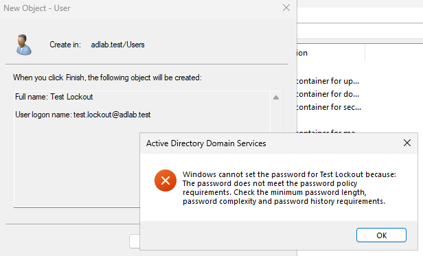

---

## 4. Test Account Creation

Created a disposable Active Directory user account to test password policy enforcement and account lockout behavior.

**Test Account:** `test.lockout`

An initial password was rejected because it did not satisfy the configured domain password policy.

The account was subsequently created using a compliant password.

### Evidence

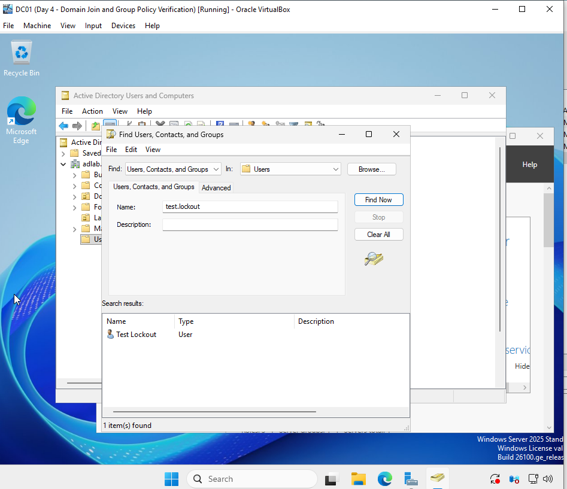

---

## 5. Failed Authentication Testing

Performed failed sign-in testing from the domain-joined Windows 11 workstation, CLIENT01.

The initial test was accidentally performed using the existing `jsmith` account instead of the intended disposable account.

This mistake was identified during investigation and documented rather than omitted.

The test was then repeated using `test.lockout`.

### Evidence

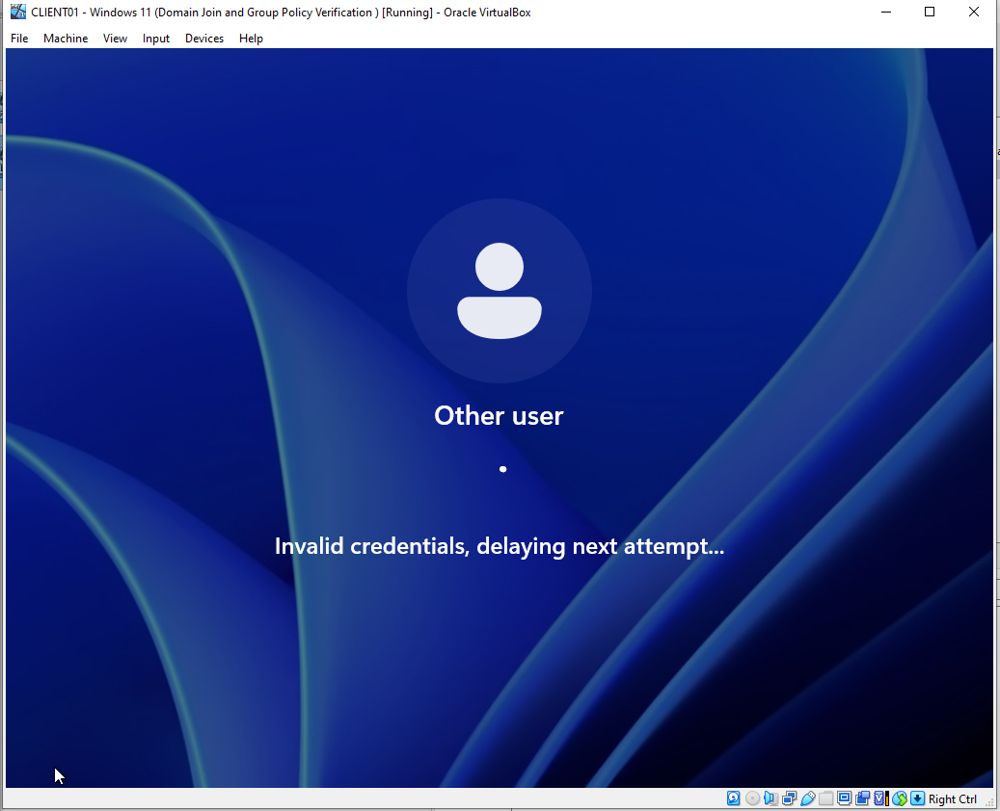

---

## 6. Account Lockout Investigation

Used Active Directory PowerShell commands to investigate account lockout status.

### Command

```powershell
Get-ADUser -Identity "test.lockout" -Properties LockedOut |
Select-Object Name, SamAccountName, LockedOut
```

The initial investigation did not show the intended test account as locked.

After repeating the failed authentication test using the correct account, PowerShell confirmed:

```text
Name          SamAccountName    LockedOut
----          --------------    ---------
Test Lockout  test.lockout      True
```

### Evidence

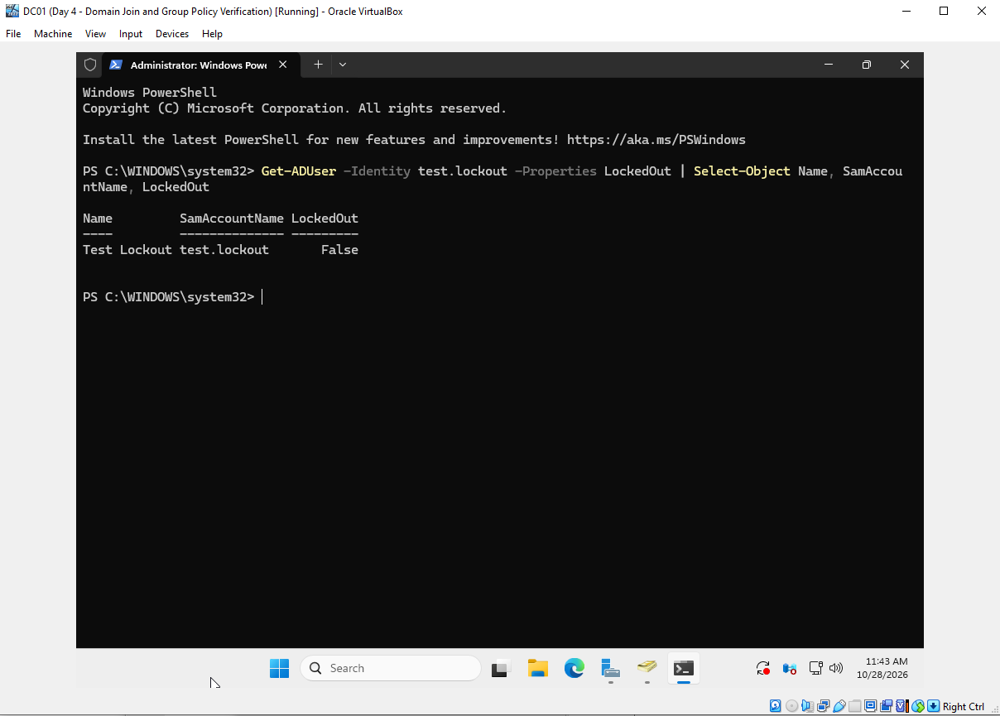

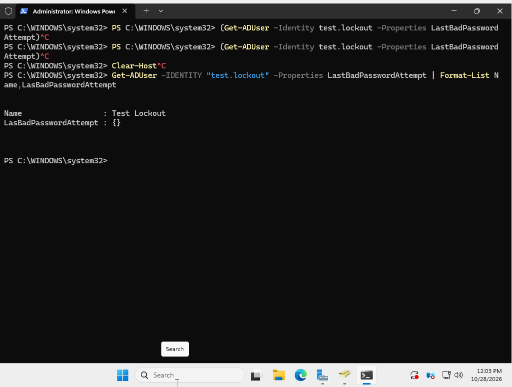

---

## 7. Windows Security Event Log Investigation

Opened Windows Event Viewer on DC01.

**Navigation:**

Event Viewer → Windows Logs → Security

Filtered the Security log for relevant authentication and account management events.

### Investigated Event IDs

| Event ID | Description |
|---|---|
| 4740 | A user account was locked out |
| 4771 | Kerberos pre-authentication failed |
| 4776 | The computer attempted to validate account credentials |

An Event ID 4740 record identified:

- **Affected account:** `ADLAB\jsmith`
- **Caller computer:** `CLIENT01`
- **Domain controller:** `DC01`

This event was associated with the initial test performed against the wrong account.

**Evidence limitation:** The available screenshots do not separately show an Event ID 4740 record identifying `test.lockout`. Its lockout was verified through PowerShell.

### Evidence

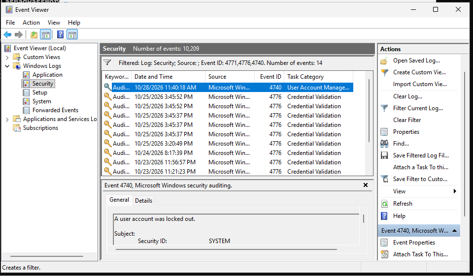

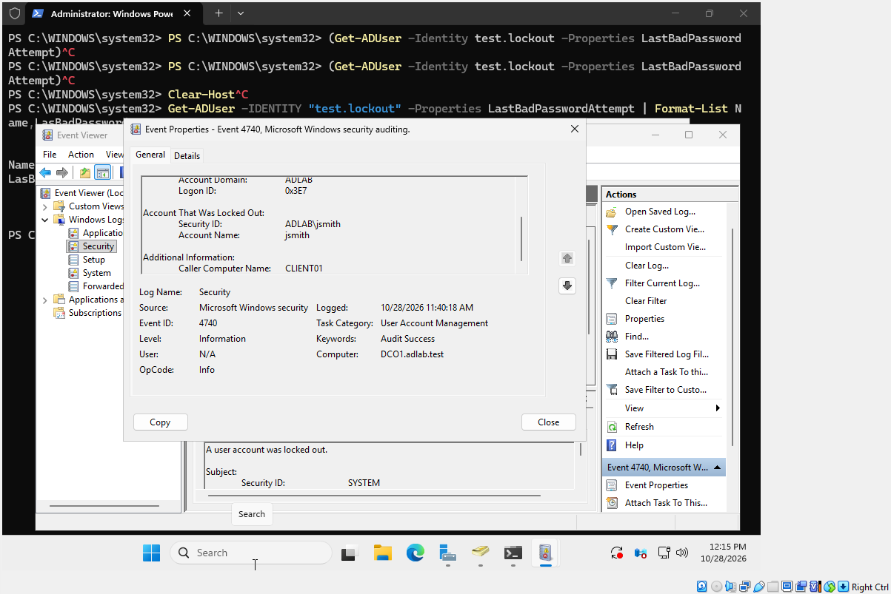

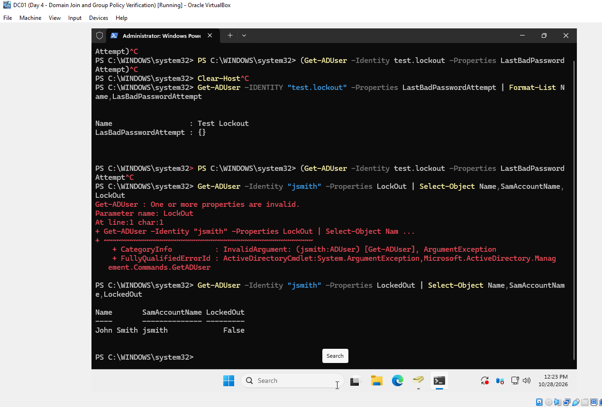

---

## 8. Successful Account Lockout Test

Repeated the failed sign-in test using the intended disposable account, `test.lockout`.

The Windows 11 client displayed an authentication delay following repeated invalid credentials.

PowerShell subsequently confirmed:

```powershell
Get-ADUser -Identity "test.lockout" -Properties LockedOut |
Select-Object Name, SamAccountName, LockedOut
```

**Result:** `LockedOut = True`

This confirmed that the domain account lockout policy was functioning during the test.

### Evidence

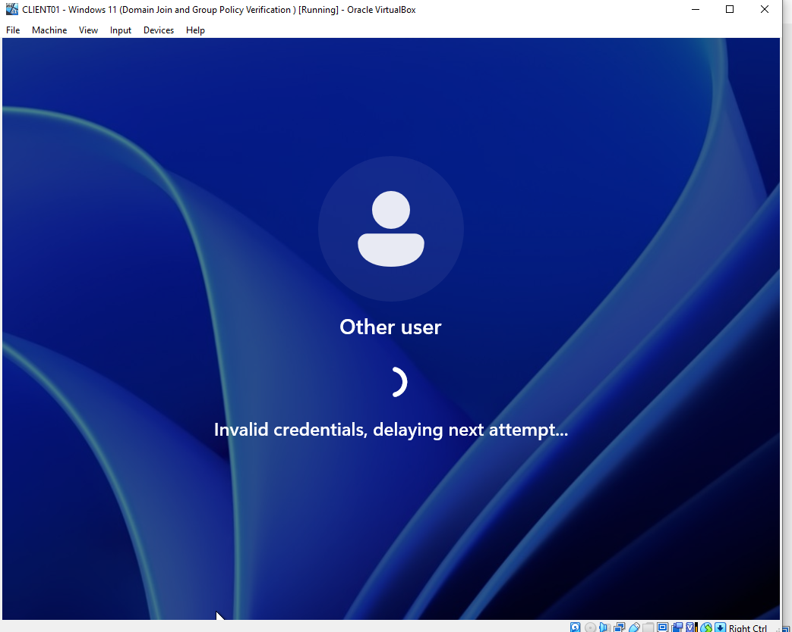

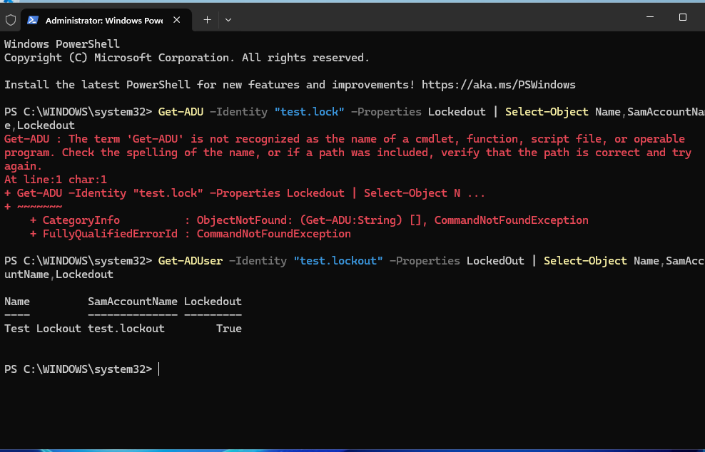

---

## 9. Account Recovery

Performed a manual account unlock using PowerShell.

### Unlock Command

```powershell
Unlock-ADAccount -Identity "test.lockout"
```

### Verification Command

```powershell
Get-ADUser -Identity "test.lockout" -Properties LockedOut |
Select-Object Name, SamAccountName, LockedOut
```

**Final result:** `LockedOut = False`

This verified that the account was successfully unlocked.

### Evidence

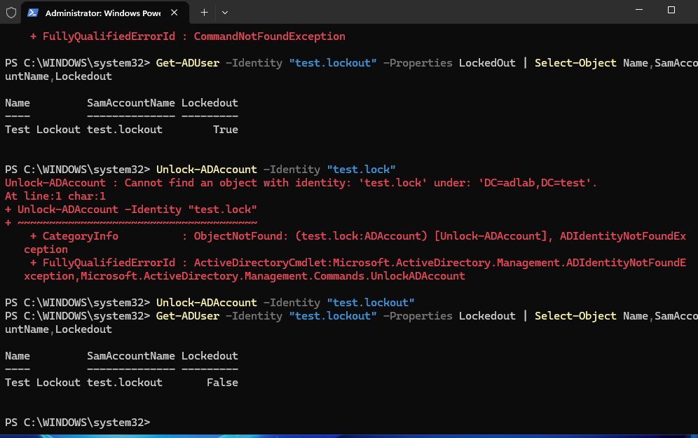

---

## 10. Troubleshooting and Lessons Learned

### Incorrect Account During Testing

The first lockout test targeted `jsmith` instead of `test.lockout`.

Event ID 4740 helped identify the affected account and the originating workstation.

**Lesson:** Verify the account identity before performing authentication security tests.

### PowerShell Syntax Errors

Encountered command errors involving:

- Incorrect parameter spelling.
- Incorrect property names.
- Accidentally copying the PowerShell prompt into commands.
- Incomplete commands.

Resolved these errors by correcting command syntax and validating results.

**Lesson:** Accurate command syntax and careful interpretation of errors are essential administrative skills.

### Password Age Display

The maximum password age initially appeared as `{}` in a selected-object display.

The value was verified using:

```powershell
(Get-ADDefaultDomainPasswordPolicy).MaxPasswordAge.ToString()
```

**Result:** `90.00:00:00`

### Account Lockout Verification

The account lockout state was confirmed using the `LockedOut` property.

The final account recovery was verified by checking that the value changed from `True` to `False`.

---

## 11. Screenshot Evidence

All screenshots were captured during hands-on testing in the isolated Active Directory lab.

| Screenshot | Description |
|---|---|
| [01 — Group Policy](screenshots/01-group-policy.png) | Group Policy Management |
| [02 — Password Policy](screenshots/02-password-policy.png) | Domain password requirements |
| [03 — Account Lockout](screenshots/03-account-lockout-policy.png) | Account lockout configuration |
| [04 — PowerShell Verification](screenshots/04-powershell-verification.png) | Domain policy verification |
| [05 — Test User](screenshots/05-test-user.png) | Test account creation |
| [06 — Failed Logins](screenshots/06-failed-login-attempts.png) | Windows authentication testing |
| [07 — Lockout Investigation](screenshots/07-lockout-status-investigation.png) | Account status investigation |
| [08 — Authentication Investigation](screenshots/08-failed-authentication-investigation.png) | Authentication troubleshooting |
| [09 — Security Events](screenshots/09-security-event-investigation.png) | Event Viewer investigation |
| [10 — Event ID 4740](screenshots/10-event-4740-jsmith-investigation.png) | Account lockout event analysis |
| [11 — Account Verification](screenshots/11-jsmith-status-verification.png) | Existing account status |
| [12 — Login Failure](screenshots/12-test-account-login-failure.png) | Test account failed authentication |
| [13 — Confirmed Lockout](screenshots/13-test-account-locked-true.png) | PowerShell lockout confirmation |
| [14 — Account Unlock](screenshots/14-manual-account-unlock.png) | Manual account recovery |

---

## 12. Skills Demonstrated

- Active Directory Domain Services (AD DS)
- Windows Server 2025 administration
- Group Policy configuration
- Password security controls
- Account lockout policy enforcement
- Windows PowerShell
- Identity and Access Management (IAM) fundamentals
- Windows Security Event Log analysis
- Authentication troubleshooting
- Help desk account recovery
- Technical documentation
- Security incident investigation fundamentals

---

## Project Outcome

**Day 5 successfully demonstrated Active Directory password security configuration, account lockout enforcement, investigation, and account recovery.**

The lab also reinforced the importance of accurate testing, security event analysis, troubleshooting, and documentation.

**Environment:** Isolated personal training lab. This project demonstrates hands-on technical skills and does not represent production-domain administration.
