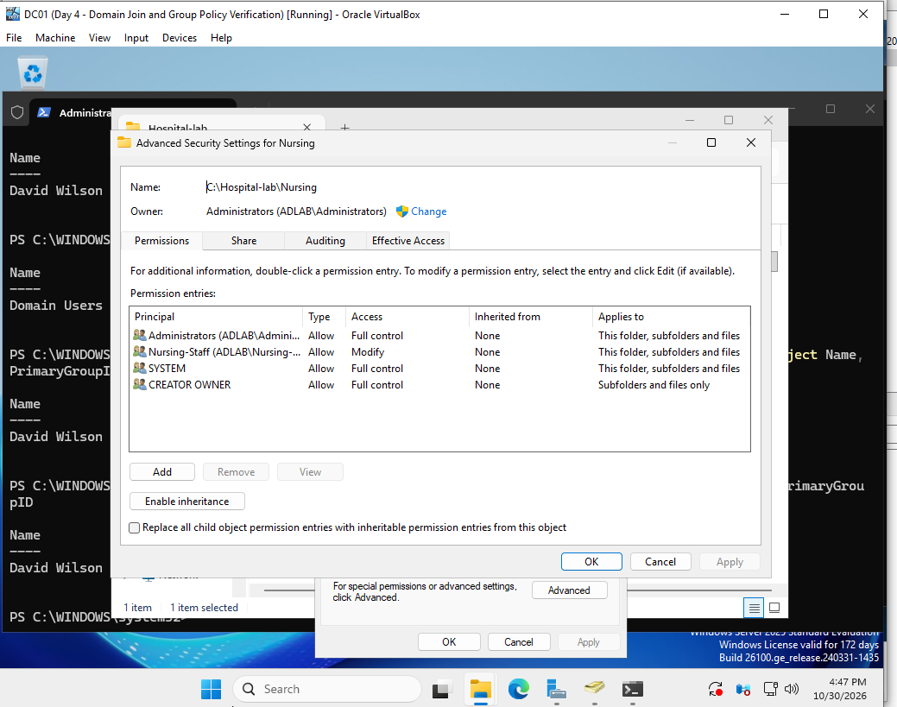
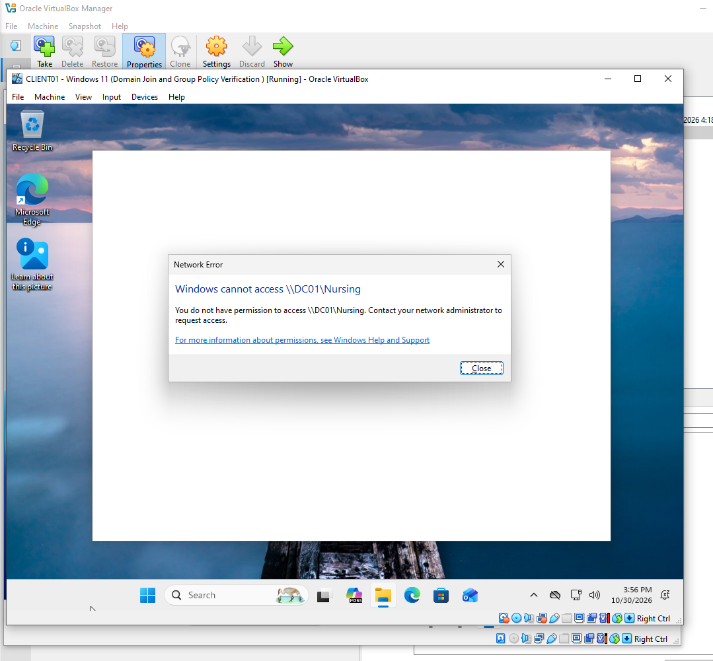
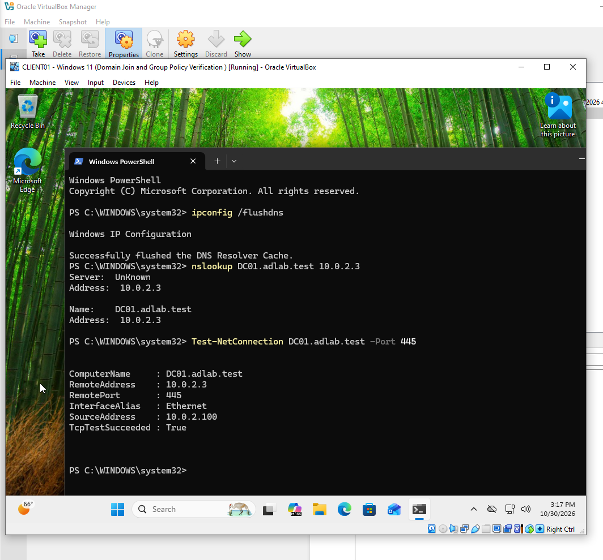
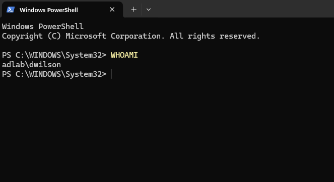
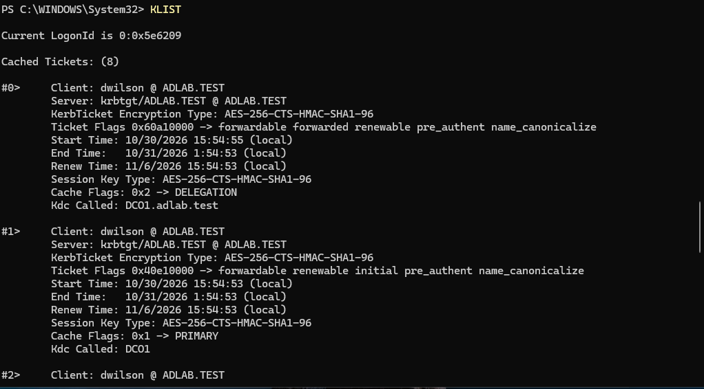
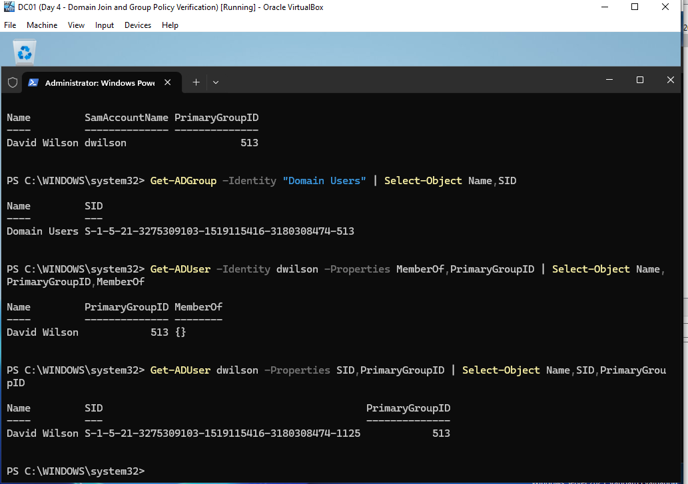
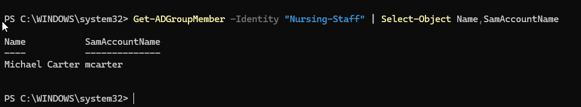
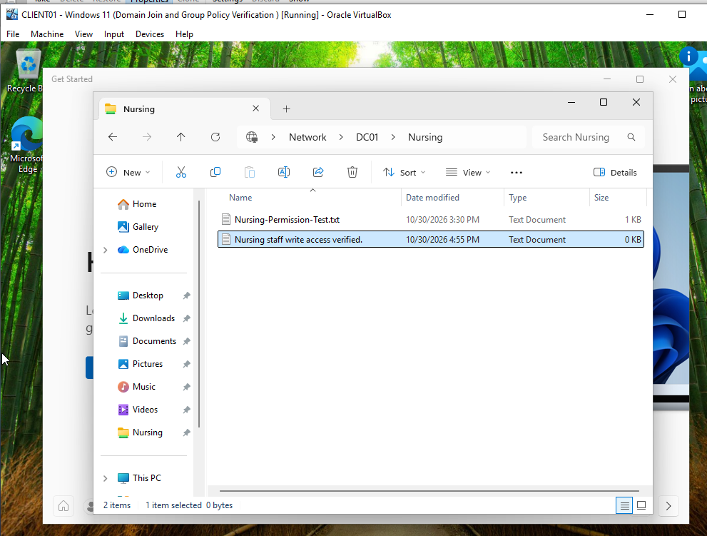
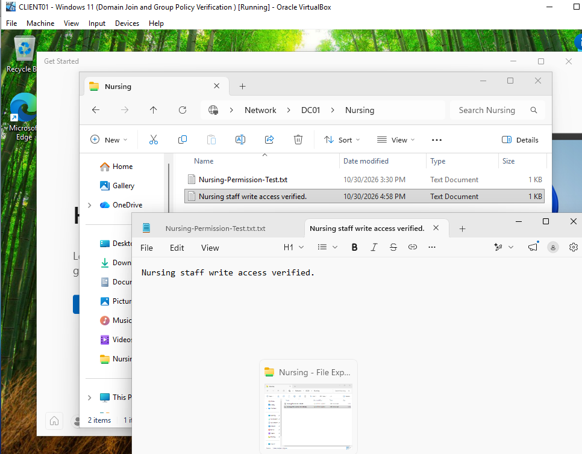

# Day 6 — Active Directory RBAC & Network File Share Security

## Project Overview

This lab demonstrates how Active Directory security groups and NTFS permissions control access to shared folders in a Windows Server 2025 environment.

The exercise simulates a healthcare organization where employees need access to departmental files while unauthorized users must be restricted.

I investigated a network-share access problem, verified domain authentication and group membership, reviewed folder permissions, and tested access using two separate domain accounts.

**Lab environment:** Personal Windows Server administration and cybersecurity training lab.

## 1. Lab Environment

| Component | Configuration |
|---|---|
| Domain Controller | DC01 |
| Server Operating System | Windows Server 2025 |
| Client Computer | CLIENT01 |
| Client Operating System | Windows 11 |
| Active Directory Domain | adlab.test |
| Virtualization Platform | Oracle VirtualBox |
| File Server | DC01 |
| Shared Folder | `\\DC01\Nursing` |
| Server Folder Path | `C:\Hospital-lab\Nursing` |
| Administrative Tools | Active Directory Users and Computers, PowerShell, File Explorer |

## 2. Project Objectives

- Apply role-based access control (RBAC) using Active Directory security groups.
- Review NTFS permissions on a departmental shared folder.
- Verify domain authentication and security group membership.
- Investigate why a domain user cannot access a network share.
- Confirm authorized users can create and modify files.
- Test that unauthorized users are denied access.
- Document troubleshooting steps and results.

## 3. Security Configuration

The Nursing folder was configured with NTFS permissions to restrict access based on departmental roles.

### Verified NTFS Permissions

| Security Principal | Permission |
|---|---|
| Administrators | Full Control |
| SYSTEM | Full Control |
| Nursing-Staff | Modify |
| CREATOR OWNER | Full Control (subfolders and files only) |

The Nursing-Staff security group was assigned Modify permissions, allowing authorized members to create and modify files without granting Full Control.

This configuration demonstrates the principle of least privilege.

**Security note:** Effective access to a network share depends on both share-level and NTFS permissions. The most restrictive applicable permission determines the effective access.



## 4. Initial Problem — Network Share Access Denied

During testing, domain user David Wilson (`ADLAB\dwilson`) attempted to access the Nursing shared folder from CLIENT01.

**Windows displayed the following error:**

```text
Windows cannot access \\DC01\Nursing
```

### Initial Investigation

- Incorrect domain authentication
- DNS resolution problems
- Network connectivity problems
- Missing Active Directory group membership
- Incorrect NTFS or share permissions

The investigation focused on determining whether the problem involved connectivity, authentication, or authorization.



## 5. DNS and Network Connectivity Verification

Before investigating permissions, I verified that CLIENT01 could communicate with the domain controller.

### Commands Executed

```powershell
ping DC01
nslookup DC01.adlab.test
Test-NetConnection DC01.adlab.test -Port 445
```

### Verification Results

- DNS resolution was successful.
- CLIENT01 could communicate with DC01.
- The SMB service port, TCP 445, was reachable.

These results supported the conclusion that the access problem was not caused by a general network connectivity failure.



## 6. Active Directory Authentication Verification

On CLIENT01, I verified the identity of the signed-in user and the computer's domain configuration.

### Commands Executed

```powershell
whoami
(Get-CimInstance Win32_ComputerSystem).Domain
$env:LOGONSERVER
nltest /sc_query:adlab.test
```

### Results

The domain verification identified:

```text
Domain: adlab.test
Logon server: \\DC01
Trusted DC: \\DC01.adlab.test
Trusted DC Connection Status: NERR_Success
```

The successful secure-channel query confirmed that the client computer could communicate with a trusted domain controller.

These checks supported successful domain connectivity and authentication.



## 7. Kerberos Authentication Investigation

I used Windows PowerShell to examine cached Kerberos authentication tickets.

### Command Executed

```powershell
klist
```

### Results

The output displayed eight cached Kerberos tickets for the `dwilson` domain session.

Observed service tickets included:

- `krbtgt/ADLAB.TEST`
- `ldap/DC01.adlab.test`
- `cifs/DC01.adlab.test`
- `ProtectedStorage/DC01.adlab.test`

The tickets displayed the encryption type:

```text
AES-256-CTS-HMAC-SHA1-96
```

The Kerberos tickets provided evidence that the user had authenticated and obtained tickets for domain services.

**Security finding:** Successful Kerberos authentication does not automatically grant permission to access a protected departmental folder.



## 8. Active Directory Group Membership Investigation

On DC01, I checked David Wilson's security group membership.

### Commands Executed

```powershell
Get-ADUser -Identity dwilson -Properties MemberOf,PrimaryGroupID |
    Select-Object Name,PrimaryGroupID,MemberOf
```

### Result

```text
Name          PrimaryGroupID    MemberOf
----          --------------    --------
David Wilson  513               {}
```

David Wilson's PrimaryGroupID was `513`, corresponding to the Domain Users group.

I verified the Domain Users group using:

```powershell
Get-ADGroup -Identity "Domain Users" |
    Select-Object Name,SID
```

The Domain Users SID ended in `-513`.

The empty `MemberOf` property did not mean the account lacked all group membership. The primary group is stored separately.

### Nursing-Staff Membership Verification

```powershell
Get-ADGroupMember -Identity "Nursing-Staff" |
    Select-Object Name,SamAccountName
```

### Result

```text
Name             SamAccountName
----             --------------
Michael Carter   mcarter
```

The query identified Michael Carter as a member of the Nursing-Staff group. David Wilson was not listed.

This supported the finding that David Wilson lacked the departmental group membership associated with the Nursing folder's Modify permission.





## 9. Nursing-Staff Group Verification

On DC01, I reviewed the Nursing folder's security settings and the associated Active Directory security group.

### Folder Configuration

```text
Server: DC01
Folder: C:\Hospital-lab\Nursing
Network share: \\DC01\Nursing
Security group: Nursing-Staff
```

### Verified Permissions

| Principal | Access |
|---|---|
| Administrators | Full Control |
| SYSTEM | Full Control |
| Nursing-Staff | Modify |
| CREATOR OWNER | Full Control on subfolders and files only |

The Nursing-Staff group received Modify access through an explicit NTFS permission entry.

Using an Active Directory group instead of assigning access individually makes departmental permissions easier to manage.

## 10. Authorized User Access Test

On CLIENT01, I signed in using the authorized Nursing-Staff account.

### Test Account

```text
ADLAB\mcarter
```

### Test Location

```text
\\DC01\Nursing
```

### Actions Performed

1. Signed in with the authorized domain account.
2. Opened the Nursing network share.
3. Created a text document.
4. Entered text into the document.
5. Saved the document.
6. Verified the file appeared in the shared folder.

### Results

The authorized user successfully accessed the Nursing folder and created a file.

The text entered into the document was:

```text
Nursing staff write access verified.
```

The file was saved successfully.

**Result: PASS — Authorized Nursing-Staff member could create and modify a file in the departmental share.**





## 11. Unauthorized User Access Test

Using David Wilson's domain account, I attempted to access:

```text
\\DC01\Nursing
```

### Observed Behavior

Windows displayed an access error when the account attempted to open the network share.

The account was authenticated to the domain, and the network connection to DC01 was functional.

However, David Wilson was not a member of the Nursing-Staff security group.

### Result

**Access denied during the tested session.**

This behavior was consistent with the configured departmental restrictions. The error alone did not prove which specific permission check caused the denial.

## 12. Troubleshooting Summary

| Investigation | Result |
|---|---|
| DNS resolution | Successful |
| Domain controller connectivity | Successful |
| SMB port 445 connectivity | Successful |
| Domain authentication | Confirmed |
| Kerberos service tickets | Present |
| David Wilson's Nursing-Staff membership | Not shown |
| Michael Carter's Nursing-Staff membership | Confirmed |
| Nursing folder NTFS permissions | Reviewed |
| Authorized user write test | Successful |
| Unauthorized user access test | Access denied |

### Root Cause Assessment

The evidence supported a group-based authorization issue rather than a general connectivity failure.

The Nursing folder granted Modify access to Nursing-Staff, and David Wilson was not a member of that group.

The authorized Nursing-Staff account successfully created and modified files.

The results demonstrated how Active Directory group membership and NTFS permissions contribute to departmental access control.

## 13. Security Principles Demonstrated

### Role-Based Access Control (RBAC)

Permissions were assigned to a group representing a job function rather than individually to each user.

### Least Privilege

Only users requiring Nursing department access were intended to receive the appropriate permissions.

### Authentication vs. Authorization

Authentication confirms who a user is. Authorization determines what that user is allowed to access.

### Defense in Depth

Active Directory group membership and NTFS permissions provided separate layers of access control.

### Security Troubleshooting

The investigation checked DNS, connectivity, authentication, Kerberos, group membership, and permissions instead of assuming the initial error was caused by a network failure.

## 14. Final Results

| Test | Outcome |
|---|---|
| Domain authentication | Successful |
| DNS resolution | Successful |
| SMB connectivity | Successful |
| Active Directory group membership verification | Completed |
| NTFS permissions review | Completed |
| Authorized Nursing-Staff file creation | Successful |
| Authorized file modification | Successful |
| Unauthorized user access attempt | Denied |

The lab demonstrated departmental file-share access controls in a Windows Server 2025 Active Directory environment.

## 15. Skills Demonstrated

- Windows Server 2025 administration
- Active Directory Domain Services (AD DS)
- Identity and Access Management (IAM)
- Role-Based Access Control (RBAC)
- NTFS permissions
- SMB network share troubleshooting
- Windows domain authentication
- Kerberos authentication analysis
- Active Directory security group management
- PowerShell troubleshooting
- Least-privilege access configuration
- Technical documentation

## 16. Conclusion

This lab demonstrated how Windows Server 2025, Active Directory security groups, and NTFS permissions can protect departmental network shares.

I investigated an access-denied problem by checking DNS, SMB connectivity, domain authentication, Kerberos tickets, Active Directory group membership, and folder permissions.

The testing showed that an authorized Nursing-Staff account could create and modify files in the Nursing share, while a separate domain account was denied access during testing.

The exercise strengthened my practical understanding of identity management, role-based access control, and Windows Server troubleshooting.

**Project scope:** Personal Windows Server and cybersecurity training lab.

## Screenshot Evidence

| # | Screenshot | Description |
|---|---|---|
| 01 | [Access Denied](screenshots/01-access-denied.png) | Unauthorized access attempt |
| 02 | [Domain Authentication](screenshots/02-domain-authentication.png) | Domain identity verification |
| 03 | [Network Connectivity](screenshots/03-network-connectivity.png) | DNS and network troubleshooting |
| 04 | [Kerberos Tickets](screenshots/04-kerberos-tickets.png) | Kerberos authentication investigation |
| 05 | [User Group Membership](screenshots/05-user-group-membership.png) | Domain user membership verification |
| 06 | [Nursing Group Members](screenshots/06-nursing-group-members.png) | Authorized security group members |
| 07 | [NTFS Permissions](screenshots/07-ntfs-permissions.png) | Folder security configuration |
| 08 | [Authorized Write Test](screenshots/08-authorized-write-test.png) | Authorized file creation |
| 09 | [Write Test Confirmed](screenshots/09-write-test-confirmed.png) | Successful file modification |
